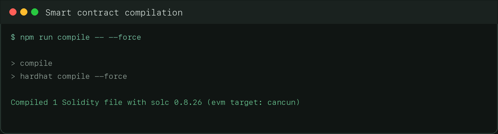
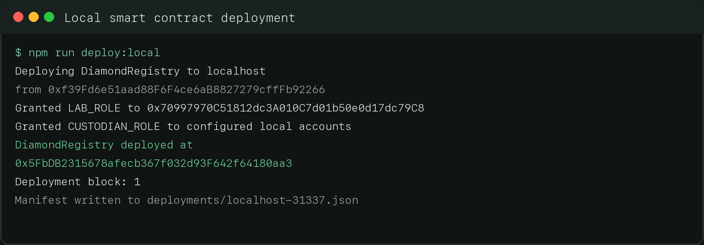
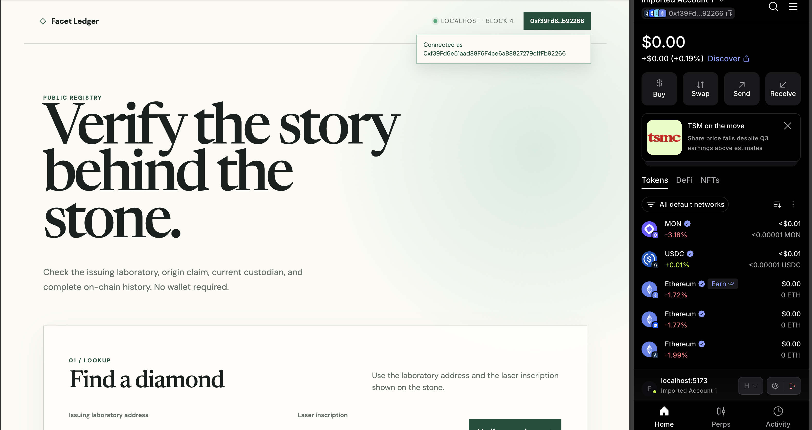
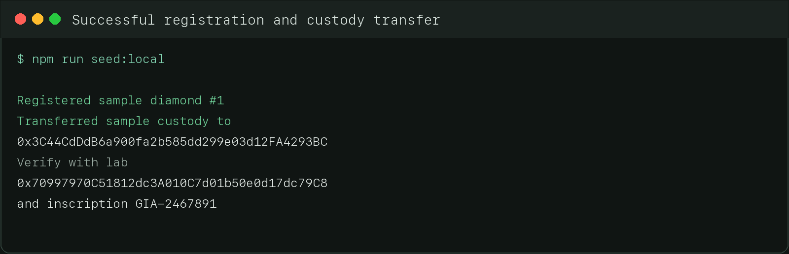
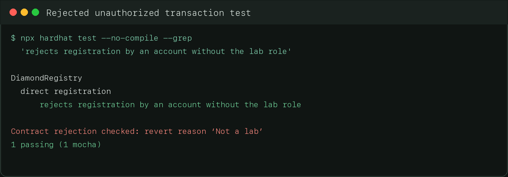
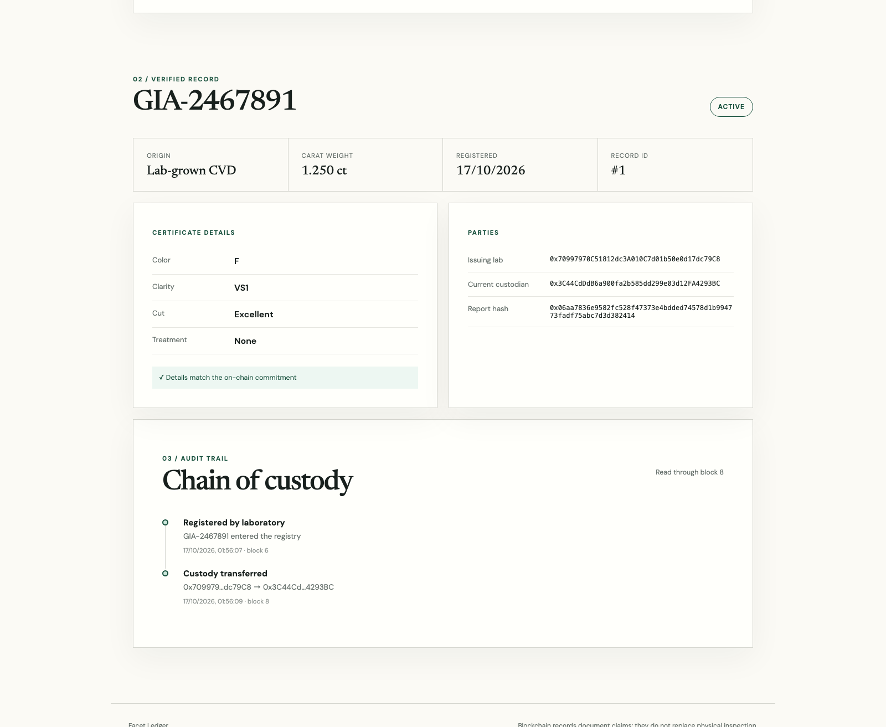

# Facet Ledger — Diamond Provenance DApp

Facet Ledger is a decentralized application for recording and verifying a diamond's origin, laboratory certificate, status, and chain of custody. The smart contract provides a shared record that laboratories, custodians, administrators, and members of the public can inspect without relying on one company's private database.

## Problem addressed

Diamond buyers often receive claims about a stone's laboratory report, origin, and ownership history from several separate organizations. Those records can be difficult to compare and may be changed or lost. Facet Ledger stores a compact, tamper-evident record on an Ethereum-compatible blockchain:

- an authorized laboratory registers the stone and commits to a report hash;
- the current custodian proposes a transfer and the recipient must accept it;
- a laboratory or administrator can quarantine a disputed record;
- an administrator can resolve the quarantine or permanently revoke the record;
- anyone can verify the current data and complete event history without connecting a wallet.

The grading report file is hashed inside the browser. The file itself is not uploaded to the blockchain.

## Main components

| Component | Purpose |
| --- | --- |
| `contracts/DiamondRegistry.sol` | Stores diamond records, roles, signed registrations, custody transfers, and lifecycle status. |
| `scripts/deploy.js` | Deploys the contract, grants initial roles, and writes a deployment manifest. |
| `scripts/seed-local.js` | Adds one demonstration diamond and completes one custody transfer. |
| `frontend/` | Provides public verification and workspaces for labs, relayers, custodians, and administrators. |
| `test/DiamondRegistry.test.js` | Covers valid, invalid, and unauthorized contract interactions. |

## Requirements

- Node.js 22 or later
- npm
- MetaMask installed in Arc, Chrome, Firefox, or Edge

## Install and execute the application

Install the dependencies and compile the contract:

```bash
npm install
npm run compile
```

Open a second terminal and start a persistent local Hardhat blockchain:

```bash
npm run node
```

Keep that terminal running. It prints funded development accounts and private keys for local testing.

In another terminal, grant the example accounts their roles and deploy the contract:

```bash
export LAB_ADDRESSES=0x70997970C51812dc3A010C7d01b50e0d17dc79C8
export CUSTODIAN_ADDRESSES=0x3C44CdDdB6a900fa2b585dd299e03d12FA4293BC,0x90F79bf6EB2c4f870365E785982E1f101E93b906
npm run deploy:local
```

Prepare the frontend configuration and start the website:

```bash
npm run frontend:prepare -- deployments/localhost-31337.json
npm run frontend:dev
```

Open [http://localhost:5173](http://localhost:5173). To create demonstration blockchain data, run:

```bash
npm run seed:local
```

Verify the seeded record with:

- **Issuing laboratory:** `0x70997970C51812dc3A010C7d01b50e0d17dc79C8`
- **Laser inscription:** `GIA-2467891`

## Deployment network and contract address

The current verified deployment is local and intended for development and assessment.

| Setting | Current value |
| --- | --- |
| Network | Hardhat Localhost |
| Chain ID | `31337` |
| RPC URL | `http://127.0.0.1:8545` |
| Contract | `DiamondRegistry` |
| Contract address | `0x5FbDB2315678afecb367f032d93F642f64180aa3` |
| Deployment block | `1` |
| Deployment transaction | `0x6927885aeda371b00da1e17eae4ef07f2612292d6b52c99eb90ca079b0eda1b1` |
| Deployer and administrator | `0xf39Fd6e51aad88F6F4ce6aB8827279cffFb92266` |

The local address exists only while the matching Hardhat node data exists. Restarting a clean node removes its state, so deploy again and rerun `frontend:prepare`. No public Sepolia deployment is claimed in this repository yet.

## Connect MetaMask

1. Start the Hardhat node, deploy the contract, prepare the frontend, and start Vite using the commands above.
2. Open MetaMask and select **Add a custom network**.
3. Enter network name `Hardhat Local`, RPC URL `http://127.0.0.1:8545`, chain ID `31337`, and currency symbol `ETH`.
4. Copy a private key printed by `npm run node`. In MetaMask, choose **Add account or hardware wallet → Import account**, paste the private key, and import it.
5. Open `http://localhost:5173` in the same browser profile and press **Connect wallet**.
6. Approve the connection in MetaMask. The website shows the connected address beside the network status.

The private keys printed by Hardhat are public development credentials. Never fund them on Ethereum mainnet or any public network.

### Accounts used in the local demonstration

| Account | Address | Role |
| --- | --- | --- |
| Account 0 | `0xf39Fd6e51aad88F6F4ce6aB8827279cffFb92266` | Administrator |
| Account 1 | `0x70997970C51812dc3A010C7d01b50e0d17dc79C8` | Laboratory and custodian |
| Account 2 | `0x3C44CdDdB6a900fa2b585dd299e03d12FA4293BC` | Custodian |
| Account 3 | `0x90F79bf6EB2c4f870365E785982E1f101E93b906` | Custodian |

## Interact with the smart contract

### Public verification

No wallet is required. Enter the issuing laboratory address and laser inscription, then press **Verify record**. The interface reads the smart contract and its events to show the origin, carat weight, report hash, current custodian, status, certificate details, and custody timeline.

### Register a diamond directly

Connect Account 1, which has both `LAB_ROLE` and `CUSTODIAN_ROLE`. In **Register a diamond**, select a report file, complete the certificate fields, and press **Register directly**. Review and confirm the transaction in MetaMask. The page displays the new record after the transaction is mined.

### Register through a relayer

Account 1 can press **Sign attestation** instead of sending a transaction. MetaMask signs structured EIP-712 data and the browser downloads a JSON file; signing costs no gas. A relayer loads that JSON under **Submit an attestation**, connects any funded wallet, and submits the transaction. The relayer pays gas because it benefits from operating the service or has an agreement with the laboratory. The contract still verifies the laboratory's signature, deadline, nonce, chain, contract address, and current roles.

### Transfer custody

Connect the current custodian, load the record ID, and propose an authorized recipient. Switch MetaMask to the recipient account, load the same record, and accept it. Custody changes only after the recipient accepts.

### Administer roles and record status

Connect Account 0 to grant or revoke laboratory and custodian roles. The administrator can also resolve a quarantine or permanently revoke a quarantined record. Every status change requires a reason and produces an on-chain event.

## Tests and observed results

Run the complete test suite with:

```bash
npm test
```

Observed on 17 October 2026: **41 passing tests, 0 failures**.

| Category | Test input or action | Expected and observed result |
| --- | --- | --- |
| Valid | Authorized lab registers a complete claim | Passed; record created with the lab as first custodian. |
| Valid | Relayer submits a valid EIP-712 laboratory signature | Passed; record created and nonce replay rejected. |
| Valid | Authorized custodian proposes and recipient accepts | Passed; custody changed and transfer event recorded. |
| Valid | Issuing lab quarantines an active record | Passed; record frozen and pending transfer cleared. |
| Invalid | Empty, lowercase, spaced, overlong, or non-ASCII inscription | Reverted with `Bad inscription`. |
| Invalid | Carat value `0` or `1000001` milli-carats | Reverted with `Carat out of range`. |
| Invalid | Empty report hash | Reverted with `Empty report hash`. |
| Invalid | Duplicate lab/inscription or report hash | Reverted with `Duplicate inscription` or `Duplicate report`. |
| Invalid | Expired, modified, wrong-chain, or wrong-contract signature | Reverted with `Signature expired` or `Bad signature`. |
| Unauthorized | Account without `LAB_ROLE` registers a diamond | Reverted with `Not a lab`. |
| Unauthorized | Lab lacks `CUSTODIAN_ROLE` | Reverted with `Lab must be custodian`. |
| Unauthorized | Non-custodian proposes a transfer | Reverted with `Not custodian`. |
| Unauthorized | Transfer targets an account without the custodian role | Reverted with `Recipient not authorised`. |
| Unauthorized | Non-admin resolves or revokes a quarantine | Reverted with OpenZeppelin `AccessControlUnauthorizedAccount`. |

## Screenshot evidence

### Smart contract compilation

The compiler successfully built `DiamondRegistry.sol` with Solidity 0.8.26.



### Smart contract deployment

The deployment assigned the configured roles and wrote the local manifest.



### MetaMask wallet connection

The Arc browser connected MetaMask Account 0 to the DApp on the localhost network. The page displays the full connected address.



### Successful transaction

The seed script registered record `#1` and completed its custody transfer to Account 2.



### Failed transaction

The focused contract test submitted registration from an account without the laboratory role. The contract rejected it with `Not a lab`, and the test passed because that rejection was required.



### Blockchain data displayed through the user interface

The public interface read record `#1` and its events from the local blockchain. It shows the active status, certificate fields, parties, report hash, commitment check, and custody history through block 8.



## Build and additional commands

```bash
# Export a standalone ABI
npm run export:abi

# Build the production frontend
npm run frontend:build

# Deploy to Sepolia after configuring SEPOLIA_RPC_URL and SEPOLIA_PRIVATE_KEY
npm run deploy:sepolia
```

A Sepolia deployment sends a real transaction and requires Sepolia ETH. Set the laboratory and custodian environment variables before deployment, then publish the resulting network and address here.

Further product design and security assumptions are documented in `diamond-provenance-dapp.md`.
